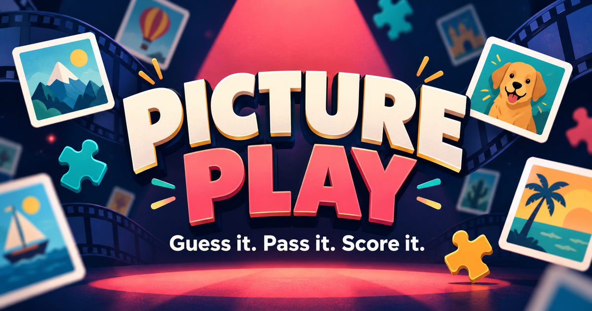

# Picture Play



Picture Play is a screen-friendly party quiz host for two teams. A host controls the questions, reveals answers, records points, and mirrors the app to a television or projector. No player accounts or separate devices are required.

## Games

| Game | Format | Rounds | Scoring |
| --- | --- | ---: | --- |
| **Guess the Movie** | Picture clues with answer reveals | 15 | 20 points on the first attempt, 10 after a pass |
| **Taste of India** | Image-based multiple choice | 15 | 20 points on the first attempt, 10 after a pass |
| **Name the Price** | Both teams enter a price guess | 16 | Closest team receives 1 point; ties award both teams |
| **Disney Movie Magic** | Kid-friendly illustrated movie clues | 10 | 20 points on the first attempt, 10 after a pass |

For every game, the host can choose whether **Team A** or **Team B** starts. The starting team is remembered separately for each game, and the first attempt alternates between teams on later rounds.

## How to play

1. Mirror the host screen to a television or projector.
2. Choose a game and select which team starts.
3. Show the question and let the active team answer.
4. Reveal the answer, select the team's option, or enter both price guesses depending on the game.
5. Award points and move to the next round.

The host can jump to any round, undo the latest result, reset a game, and enter fullscreen mode. Scores and progress are saved in the browser on the current device.

## Start locally

### Requirements

- [Node.js](https://nodejs.org/) 22.13 or newer
- [pnpm](https://pnpm.io/) through Corepack or a standalone installation

### Setup

```bash
git clone https://github.com/malhotra18/PartyGames.git
cd PartyGames
corepack enable
pnpm install
pnpm dev
```

Open [http://localhost:3000](http://localhost:3000) in a browser.

### Production build

```bash
pnpm build
pnpm start
```

The build output is written to `dist/`. The start command runs the built Cloudflare Worker locally through Wrangler.

## Useful commands

| Command | Purpose |
| --- | --- |
| `pnpm dev` | Start the local development server |
| `pnpm build` | Create the deployment build |
| `pnpm start` | Run the built app locally |
| `pnpm lint` | Check the code with Oxlint |
| `pnpm format` | Format the project with Oxfmt |
| `pnpm exec tsc --noEmit` | Run a TypeScript check without writing files |

## Project structure

```text
app/
  page.tsx          Main host console and game interactions
  globals.css       Shared theme and game presentation styles
lib/
  games.ts          Game definitions, questions, answers, and prices
public/
  game1/            Guess the Movie slides
  game2/            Taste of India images
  game3/            Name the Price product images
  game4/            Disney Movie Magic clue artwork
.openai/
  hosting.json      OpenAI Sites project binding
```

To add or edit a round, update `lib/games.ts` and place its image assets in the matching folder under `public/`.

## Data and privacy

- The app has no database, user accounts, analytics, or server-side player data.
- Scores, progress, the selected game, and starting-team choices are stored only in browser `localStorage`.
- No API key is required to run the quiz.
- `.env*`, private-key files, build output, local Wrangler state, and dependency folders are excluded by `.gitignore`.
- `.openai/hosting.json` contains a Site project identifier, not an authentication credential.
- Deployment and repository credentials should remain short-lived or in the operating system's credential store; never place them in source files or remote URLs.

## Asset note

The repository contains quiz images intended for this party-game experience. Review the source and licensing of all media before redistributing the project publicly or using it commercially.

